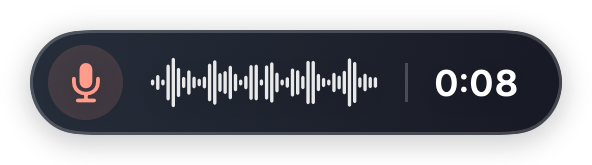
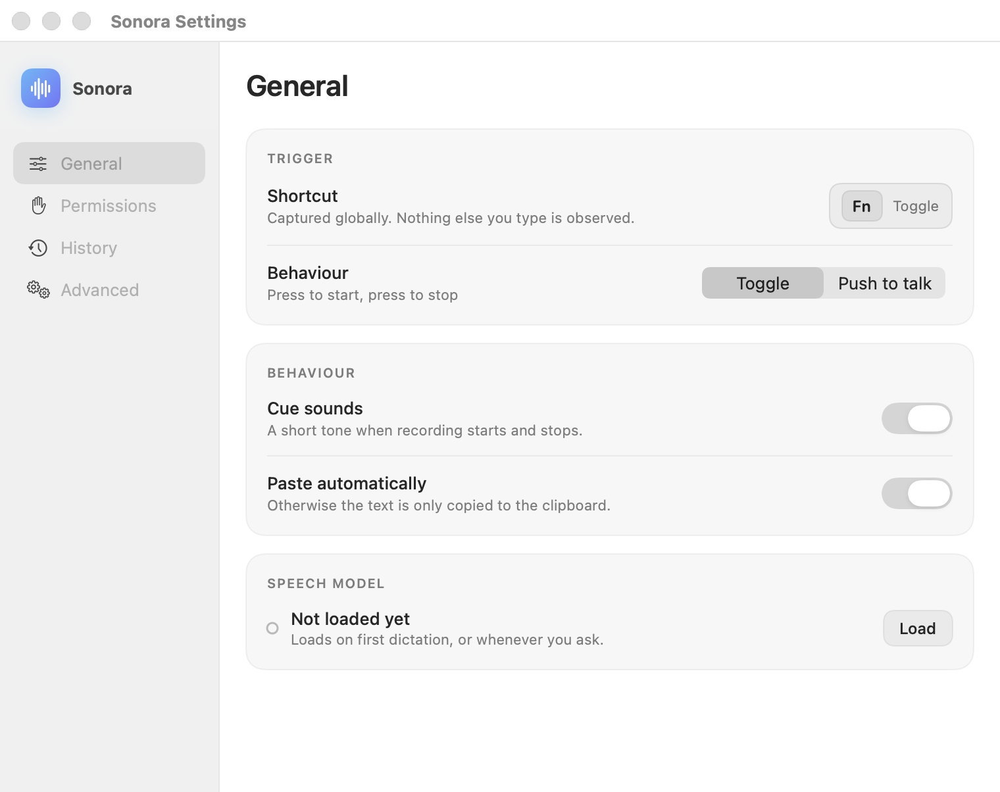

# Sonora

Press **Fn** to dictate, then press it again to paste at the cursor. Sonora runs NVIDIA’s Parakeet TDT v3 on your Mac for free. Some transcription apps reserve this model for a paid tier.



## Transcription speed

On an M3 Pro, Sonora transcribed 21.4 seconds of speech in **147 ms** (146× real time). That’s the median of seven runs with the model already loaded. [Test clip](https://github.com/FluidInference/FluidAudio/blob/e0c6103bc87a88d25276cad491c86e757f58c865/Tests/FluidAudioTests/ASR/Parakeet/SlidingWindow/Fixtures/01-validation-request-21.4s.wav)

On an M4 Max, Parakeet TDT v3 (Core ML) took **82 ms** per clip and Whisper Large v3 Turbo Q5 (whisper.cpp) took **320 ms**. Both times are medians across the same eight synthetic dictation clips after warm-up. [Benchmark and methodology](https://sayburst.com/benchmarks)

## Build and run

Requires Apple silicon, macOS 14 or later, and Swift 6.2 or later.

```sh
make run
```

On first launch, grant Microphone and Accessibility access and download the model. Dictation then works offline. Recordings and transcripts stay on your Mac.

<details>
<summary>Settings screenshot</summary>



</details>

## Supported languages

Parakeet automatically detects 25 languages. [NVIDIA model card](https://huggingface.co/nvidia/parakeet-tdt-0.6b-v3#description)

Bulgarian, Croatian, Czech, Danish, Dutch, English, Estonian, Finnish, French, German, Greek, Hungarian, Italian, Latvian, Lithuanian, Maltese, Polish, Portuguese, Romanian, Russian, Slovak, Slovenian, Spanish, Swedish, and Ukrainian.

[Apache-2.0](LICENSE) · [Third-party notices](NOTICE)
